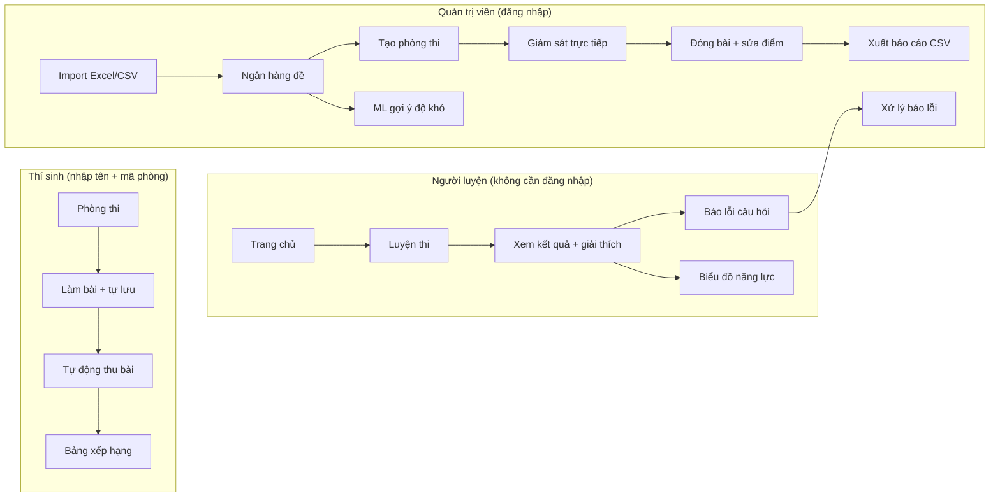
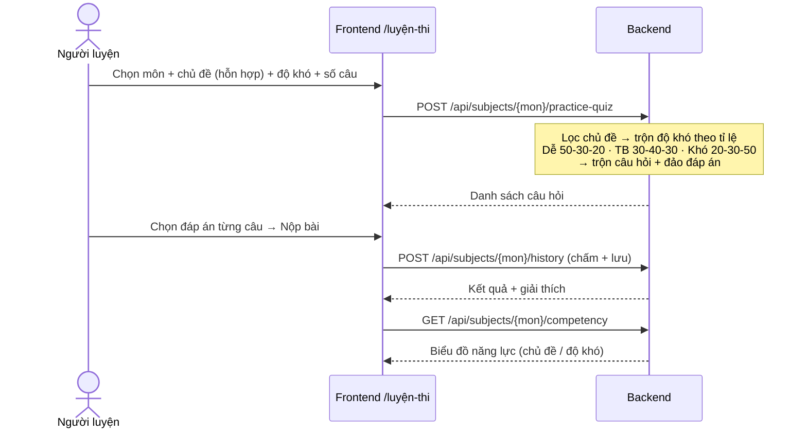
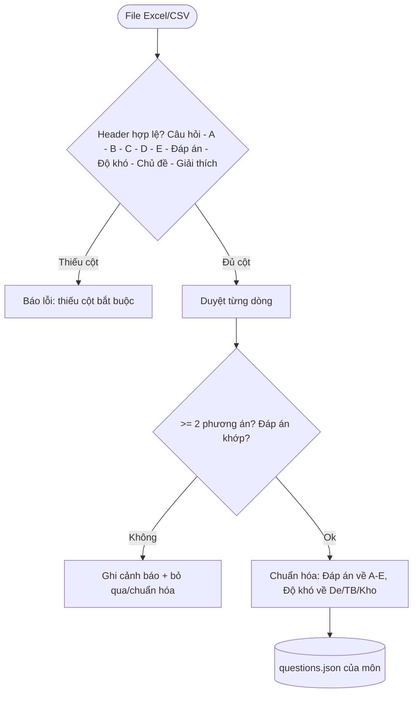
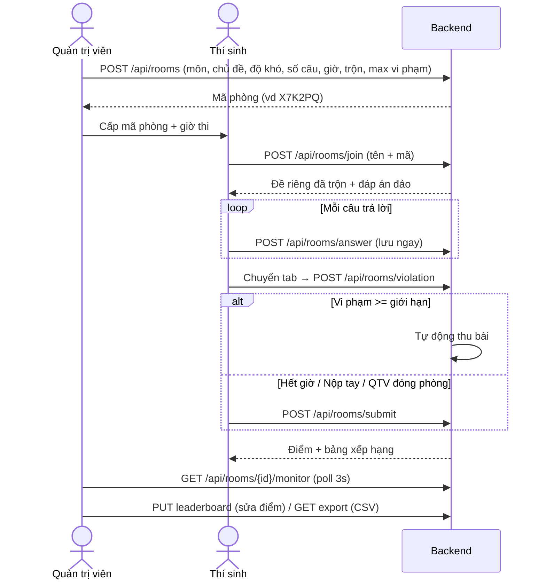
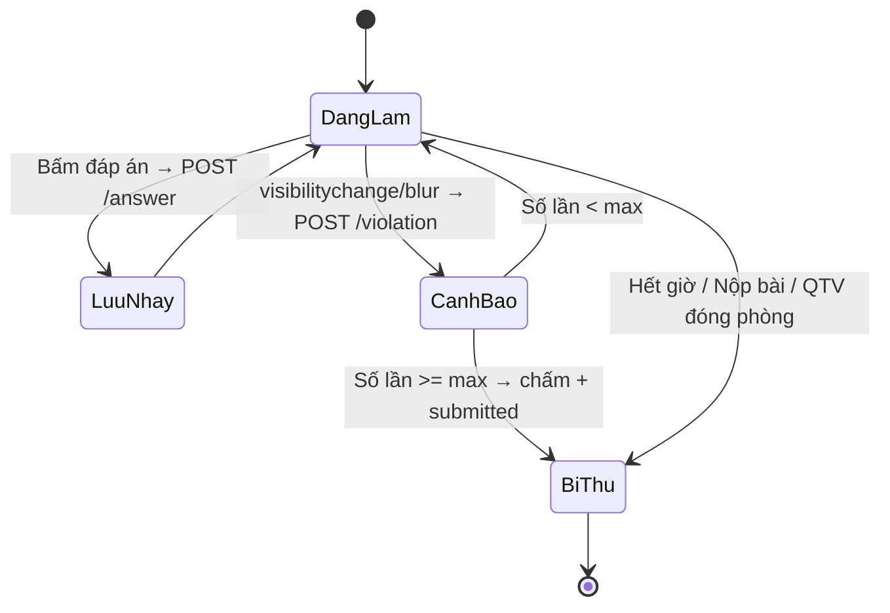
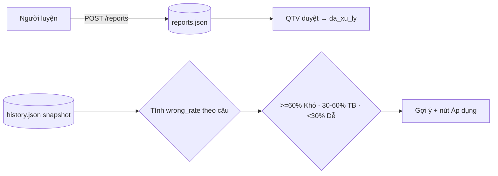

# EduQuest

Không gian ôn tập cá nhân + phòng thi online: luyện trắc nghiệm theo chủ đề/độ khó,
import đề Excel/CSV, thi có giám sát chống gian lận.

---

## Chạy dự án

**Yêu cầu:** Python ≥ 3.11 · Node.js ≥ 18 · Docker (tuỳ chọn) · Gemini API Key (tuỳ chọn, chấm tự luận AI).

Cấu hình qua biến môi trường hoặc file `.env` (xem `.env.sample`). Đã có mặc định, không bắt buộc.

```env
FRONTEND_PORT=3000
BACKEND_PORT=8000
GEMINI_API_KEY="your_api_key_here"
JWT_SECRET="chuoi_ngau_nhien_dai_o_production"
```

**Thủ công (Development):**

```bash
# Backend
cd backend
pip install -r requirements.txt
python main.py            # → http://localhost:8000 (Swagger tắt mặc định, bật bằng ENABLE_DOCS=1)

# Frontend
cd frontend
npm install
npm run dev               # → http://localhost:3000 (proxy /api, /health, /data về backend)
```

**Docker Compose:**

```bash
docker compose up --build # FE:3000 · API:8000 · data mount vào /data, rebuild không mất
```

> Đăng nhập quản trị mặc định: `admin` / `admin123`.

---

## Tính năng

- **Luyện thi** (cần đăng nhập): chọn chủ đề hỗn hợp + độ khó + số câu, đề trộn theo tỉ lệ
  (Dễ 50-30-20 · TB 30-40-30 · Khó 20-30-50) và đảo đáp án; biểu đồ năng lực, câu sai gần đây.
- **5 loại câu hỏi** (1 đáp án, nhiều đáp án, điền ngắn, nối đôi, tự luận) — chấm tự luận bằng AI,
  lịch sử & thống kê, flashcard, ghi chú bài giảng, báo lỗi câu hỏi.
- **Phòng thi online** (thí sinh nhập tên + đơn vị + CCCD + mã phòng): tự lưu từng câu,
  tự thu khi hết giờ (server chốt deadline), chống gian lận (phát hiện chuyển tab), đáp án không
  gửi cho client trước khi nộp, mỗi phiên có ticket riêng.
- **Quản trị viên**: import Excel/CSV (tối đa 10MB, xem trước trước khi ghi đè), quản lý ngân hàng đề,
  duyệt báo lỗi, ML gợi ý độ khó, giám sát trực tiếp (poll 3s) + đóng/thu bài + sửa BXH + xuất CSV,
  quản lý đơn vị & tài khoản.
- **ML gợi ý độ khó** — dựa trên tỉ lệ sai lịch sử (kiến trúc mở, thay được model thật).

**Trang:** Chủ · Ôn luyện · Tham gia kiểm tra · Hướng dẫn · Liên hệ · Đăng nhập · Quản trị.

---

## Công nghệ

| Thành phần | Stack |
| :--- | :--- |
| **Frontend** | React 19 + Vite, TypeScript, TailwindCSS v4, Framer Motion, KaTeX |
| **Backend** | FastAPI (Python), Pydantic, Uvicorn, openpyxl |
| **AI** | Google Gemini API (gọi phía server, key không rời máy chủ) |
| **Lưu trữ** | SQLite (`data/app.db`, WAL) — 13 bảng, backup xoay vòng 7 ngày |
| **Xác thực** | JWT stateless (HS256, hết hạn 12h) — production đặt `JWT_SECRET` riêng |
| **Container** | Docker + Docker Compose |
| **Kiểm thử** | Playwright (E2E, script ngoài repo) |

---

## Luồng nghiệp vụ

Sơ đồ Mermaid (render bằng VS Code, GitHub, trang `/gioi-thieu`...).

### 1. Tổng quan vai trò



### 2. Luyện thi



### 3. Import đề Excel/CSV



### 4. Phòng thi online



### 5. Chống gian lận + tự động lưu/thu



### 6. Báo lỗi + ML độ khó



---

## Cấu trúc thư mục

```
eduquest/
├── backend/            # FastAPI: src/app.py + routes/, bank.py, examrooms.py, auth.py, db.py
├── frontend/           # React + Vite: src/App.tsx, pages/, components/, services/api.ts
├── data/               # SQLite app.db (+ -wal/-shm) & backups/ — persistent volume
├── samples/            # File đề mẫu (CSV) để thử tính năng import
├── docker-compose.yml
└── README.md
```

> Đề thi `.md` và ghi chú lưu **trong `app.db`** (bảng `subject_exams`, `subject_notes`),
> tự nạp 1 lần từ đĩa lúc khởi động nếu bảng còn rỗng. Ảnh minh họa đặt ở
> `data/assets/<Tên môn>/`, phục vụ qua `GET /data/...`.

---

## Thêm câu hỏi / đề mới

Làm **hoàn toàn trên Web** (`/admin` → tab Ngân hàng đề):

1. Chuẩn bị Excel/CSV theo mẫu `Câu hỏi | A | B | C | D | E | Đáp án | Độ khó | Chủ đề | Giải thích`
   (đáp án A–E, độ khó Dễ/Trung bình/Khó).
2. **Xem trước** (`POST /api/import/preview`) → kiểm tra lỗi từng dòng.
3. **Ghi đè** (`PUT /api/subjects/{subject}/bank`).

> Đề mẫu để thử import nằm ở [`samples/`](samples): `a_z.csv`, `trộn_x.csv`.
