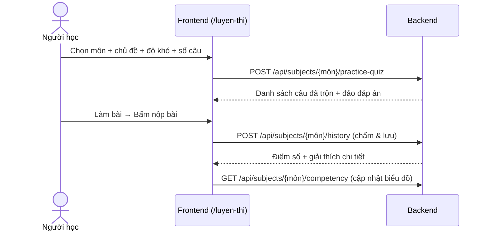
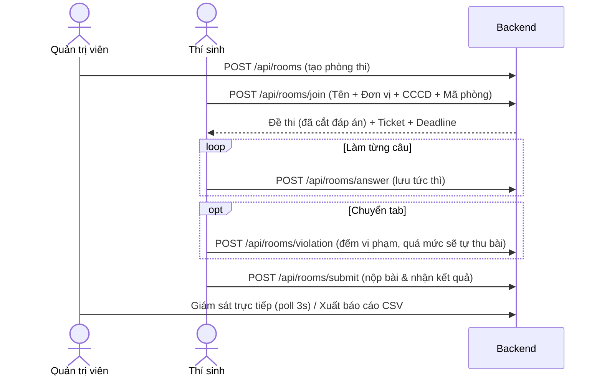

# EduQuest

Hệ thống ôn luyện trắc nghiệm và tổ chức kỳ kiểm tra online: quản lý ngân hàng câu hỏi tập trung (SQLite), import đề Excel/CSV, thi trực tuyến chống gian lận và giám sát thời gian thực.

---

## 🚀 Khởi chạy nhanh

**Yêu cầu:** Python ≥ 3.11 · Node.js ≥ 18 · Docker (tuỳ chọn).

Tạo file `.env` từ file mẫu:
```bash
cp .env.sample .env    # Linux/Mac
copy .env.sample .env  # Windows
```

### 1. Chạy thủ công (Development)

```bash
# Backend (FastAPI - Port 8000)
cd backend
pip install -r requirements.txt
python main.py

# Frontend (Vite - Port 3000)
cd frontend
npm install
npm run dev
```

### 2. Chạy bằng Docker Compose

```bash
docker compose up --build
```
* **Frontend:** `http://localhost:3000` · **Backend:** `http://localhost:8000`
* Dữ liệu SQLite được lưu cố định tại thư mục host `./data`.
* **Tài khoản admin mặc định:** `admin` / `admin123`.

---

## 🌟 Tính năng nổi bật

* **Luyện thi cá nhân (`/luyen-thi`):**
  - Đăng nhập bảo mật (JWT 12h).
  - Tùy chọn bộ đề, chủ đề, độ khó (Dễ/TB/Khó/Hỗn hợp) và số lượng câu (tối đa 200).
  - Thuật toán trộn câu và đảo thứ tự đáp án ngẫu nhiên.
  - Biểu đồ năng lực theo chủ đề & độ khó, thống kê các câu hay làm sai.
* **Phòng thi online (`/phong-thi`):**
  - Vào thi nhanh: Họ tên + Đơn vị + Số CCCD (12 số) + Mã phòng.
  - Hỗ trợ tạo đề thi gộp từ **nhiều bộ câu hỏi**.
  - **Bảo mật:** Không gửi đáp án về client; mỗi bài thi cấp ticket riêng.
  - **Tự động lưu & Chống gian lận:** Lưu câu trả lời ngay khi bấm; đếm số lần chuyển tab (debounce 2s); tự thu bài khi hết giờ hoặc vi phạm quá giới hạn.
* **Quản trị hệ thống (`/admin`):**
  - **Ngân hàng đề:** Import Excel/CSV (tối đa 10MB), xem trước (preview), sửa trực tiếp từng câu trước khi lưu.
  - **Kỳ kiểm tra:** Tạo phòng, giám sát trực tiếp real-time (poll 3s), đóng phòng, sửa điểm, xuất báo cáo CSV (hỗ trợ tiếng Việt trên Excel).
  - **Quản lý danh mục:** Thêm/xóa đơn vị công tác; quản lý tài khoản người dùng; tiếp nhận báo lỗi câu hỏi.

---

## 🛠️ Công nghệ

* **Frontend:** React 19, Vite, TypeScript, TailwindCSS v4, KaTeX.
* **Backend:** FastAPI, Pydantic, Uvicorn, openpyxl, pyjwt.
* **Cơ sở dữ liệu:** SQLite (`data/app.db`, chế độ WAL), tự sao lưu 7 ngày.

---

## 📊 Sơ đồ luồng chính

### 1. Luồng Luyện thi



### 2. Luồng Phòng thi online



---

## 📁 Cấu trúc thư mục

```
eduquest/
├── backend/            # Mã nguồn backend (FastAPI, SQLite, models, routes)
├── frontend/           # Mã nguồn frontend (React 19, TypeScript, pages, components)
├── data/               # Dữ liệu SQLite (app.db) & thư mục backup tự động
├── samples/            # File đề mẫu chuẩn CSV (a_z.csv, trộn_x.csv)
├── docker-compose.yml  # File cấu hình chạy full-stack container
├── .env.sample         # Mẫu biến môi trường
└── README.md           # Tài liệu dự án
```

---

## 📄 Định dạng file Import (Excel / CSV)

Dòng tiêu đề (header) của file import cần có các cột sau:

| Cột | Tiêu đề | Giải thích |
| :--- | :--- | :--- |
| 1 | `Câu hỏi` | Nội dung câu hỏi |
| 2–6 | `A` · `B` · `C` · `D` · `E` | Nội dung các phương án (tối thiểu 2 phương án A, B) |
| 7 | `Đáp án` | Chữ cái phương án đúng (`A`, `B`, `C`, `D`, `E`) |
| 8 | `Độ khó` | `Dễ`, `Trung bình`, hoặc `Khó` (mặc định: `Trung bình`) |
| 9 | `Chủ đề` | Tên chủ đề để phân loại (mặc định: `Chung`) |
| 10 | `Giải thích` | Lời giải thích khi xem lại bài |

> Hai file mẫu chuẩn sẵn có tại thư mục [`samples/`](samples): `a_z.csv`, `trộn_x.csv`.
